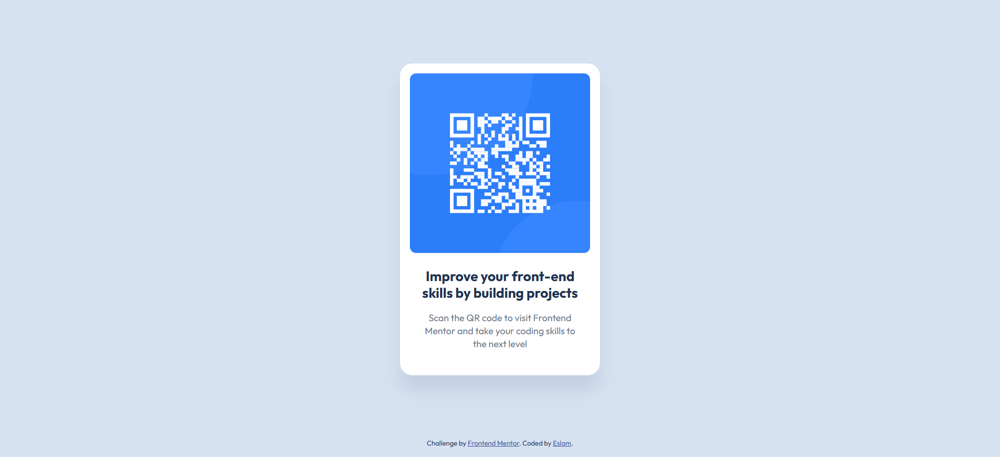

# Frontend Mentor - QR code component solution

This is my solution to the [QR code component challenge on Frontend Mentor](https://www.frontendmentor.io/challenges/qr-code-component-iux_sIO_H). Frontend Mentor challenges help you improve your coding skills by building realistic projects.

## Table of contents

- [Overview](#overview)
  - [Screenshot](#screenshot)
  - [Links](#links)
- [My process](#my-process)
  - [Built with](#built-with)
  - [What I learned](#what-i-learned)
  - [Continued development](#continued-development)
  - [Useful resources](#useful-resources)
  - [AI Collaboration](#ai-collaboration)
- [Author](#author)

## Overview

### Screenshot



### Links

- Solution URL: [Add solution URL here](https://github.com/e5lama5hraf/qr-code-component)
- Live Site URL: [Add live site URL here](https://e5lama5hraf.github.io/qr-code-component/)

## My process

### Built with

- Semantic HTML5 markup
- CSS custom properties
- CSS Grid (to center the card on the page)
- BEM-style class names
- Google Fonts (Outfit)

### What I learned

This was a small project, but I learned a few important things from it:

**1. Make the card responsive without media queries.**
At first I gave the card a fixed `width: 320px`, which touches the screen edges on small phones. Using `width: 100%` with `max-width: 320px` (plus padding on the `body`) fixes this.

```css
.card {
  width: 100%;
  max-width: 320px;
}
```

**2. Always write a useful `alt` text for images.**
An empty `alt` hides the QR code from screen reader users. A short description of what the image is for makes the page accessible.

```html

```

**3. Use `box-shadow` for depth instead of a border.**
The design has a soft shadow under the card, not an outline, so I used `box-shadow` to match it.

**4. Load only the font weights I need.**
Instead of loading the whole Outfit font range, I only load `400` and `700`, which are the weights in the style guide. This makes the page lighter.

**5. Use the right HTML elements.**
I used `<main>` for the card, `<h1>` for the title, and `<footer>` for the attribution instead of many `div`s.

### Continued development

- Practice building layouts with a real mobile-first approach (start with the small screen, then add media queries).
- Compare my work to the design more carefully using the Figma file / pixel measurements.
- Keep practicing semantic HTML and accessibility.

### Useful resources

- [MDN - `max-width`](https://developer.mozilla.org/en-US/docs/Web/CSS/max-width) - helped me make the card responsive.
- [MDN - `` alt attribute](https://developer.mozilla.org/en-US/docs/Web/HTML/Element/img#alt) - helped me understand how to write good alt text.
- [BEM naming](https://getbem.com/introduction/) - helped me keep my class names clean and consistent.

### AI Collaboration

I wrote the first version of the HTML and CSS myself. After that I used Claude to review my code and give feedback (accessibility, responsiveness, semantic HTML, and matching the design). I then applied the improvements and made sure I understood each one.

## Author

- GitHub - [@e5lama5hraf](https://github.com/e5lama5hraf)
